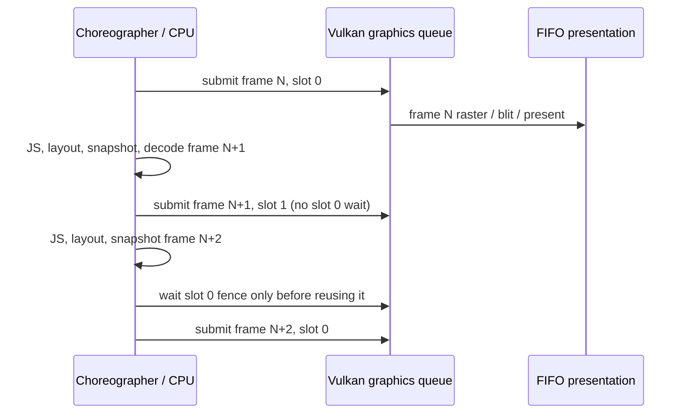

# Android frame pipeline (K11)

The two-slot ownership rules below remain in effect. Android hosts now execute
this pipeline on the bounded renderer lane described in [render-thread.md](render-thread.md);
the synchronous callback diagrams and timing boundaries below describe K11 before
that handoff was introduced.

This describes the `c/frame-pipeline` change from `watchrss-migration` 904a4fc
(PocketJS 5509d23, host ABI 3). It applies to both Android watch hosts. OWW242
60 fps acceptance is **PENDING**: this increment performs no device operations.
The reader handoff reports ticks about 41–45/s, dropped about 15–19/s,
JS turn p95 9–15 ms, frame fence 15–22 ms, upload fence 0, native total about
33.6 ms. These are measurements provided by wrss-perf, not K11 measurements.

## Callback and timing boundaries

`PodRuntimeView.frameCallback.doFrame` runs on the Android main thread. It calls
`nativeFrame`, updates accessibility, drains host effects, pumps service
notifications, then posts the next Choreographer callback. Java's
`javaFrameWindow.callbackTotal` includes all those stages. `nativeTotal` covers
only the native `renderFrame` call, ending before the perf log formatting.
A blocked native call also delays input dispatch and the next callback.

The native call order is:

1. Drain the queued touch snapshot; construct the input frame.
2. `pod_runtime_frame`: JS guest turn, service results/resource processing,
   then the native surface/layout tick. `jsTurn` and `layout` are runtime
   substage measurements; neither includes a Vulkan fence or WSI acquire.
3. `pod_runtime_snapshot`: build the canonical draw list. Its CPU time is
   `drawList`; dirty/hash gating can skip rendering completely.
4. `submitDrawList`: reuse a frame slot, decode primitives/images (including
   glyph inflate/raster/cache misses), prepare uploads and clips, acquire,
   record, submit and present.
5. Only if the GPU path fails and the renderer remains usable: CPU rasterize
   and `submitRgba`, using the same slot pipeline.

Source entry points are `jni_bridge.cpp::renderFrame`,
`vulkan_renderer.cpp::{waitForFrameFence,submitDrawList,submitRgba,submitAndPresent}`
and `gpu_draw_list.cpp::{decodeGpuDrawList,GpuDecodeCache::getGlyph}` under
`platforms/android/runtime/src/main/cpp`; the Java callback is under
`platforms/android/runtime/src/main/java/dev/podjs/runtime`.

At the baseline, the order inside the GPU submission was decode → **wait the
previous frame's single fence** → prepare uploads → acquire → record → submit
→ present. JS already preceded acquire. CPU work before the fence could
partially overlap GPU work, but the shared staging, clips and raster target
forced every upload/record/submit to wait for the immediately preceding frame.

At K11, the order is **wait/release only this slot (N−2)** → decode → prepare
uploads/clips → acquire → record → submit → present → advance to the other
slot. Moving the slot retirement before decode also removes its old glyph pins
before page LRU decisions. The other slot remains protected and executing.
No Vulkan acquire or slot wait is performed before the JS turn or draw list.

This diagram shows permitted overlap, not measured GPU execution time. The
single graphics queue and its existing upload-to-fragment barriers order
texture uploads before subsequent sampling. No second upload submit/fence or
render thread is introduced. JS/layout/decode and glyph preparation can run
while the other slot's GPU work is outstanding; work within the CPU callback
remains sequential. A future larger change could prepare draw lists/glyphs on a
worker, but would require guest/surface/font ownership changes and is outside K11.

## Resource ownership and synchronization

Each of two slots owns its command buffer, signaled-initially fence, acquire
semaphore, persistently mapped host-coherent staging and clip buffers, raster
image/memory/view and framebuffer. A command buffer is reset, mapped memory is
written or grown, and old snapshots are released only after **that slot's**
fence succeeds. The initial free slots require no fence wait. The fence resets
only immediately before queue submit; decode/capacity/acquire failures do not
leave a fence which a later frame would wait forever.

The pipeline and render pass remain shared and immutable. Each texture version
has two immutable descriptor sets, one bound to each slot's clip buffer.
Descriptors are never rewritten while submitted work references them.

Textures are immutable after a successful upload submission. `ready` means
upload **scheduled successfully**, not GPU completed. The barrier from
transfer write to fragment read in the same graphics queue protects later
sampling, including subsequent submissions using a cache hit. A changed
revision creates a new image/view/descriptor pair. The old version moves to a
retirement list when another pending slot references it. Its Vulkan handles
are destroyed only after every referencing slot has retired. Unchanged
textures may be read by both slots. Slot references also include uploaded but
clipped-out images, because their copy commands still use those resources.

The Vulkan cache's 1024-resource / 32 MiB RGBA budget includes both live cache
entries and retired versions. Eviction skips every pending slot's resources
and the current frame's requested resources. If their union exceeds budget,
the GPU path fails to the existing CPU fallback instead of evicting a live
resource or waiting every preceding frame. Descriptor use is two sets per
version (pool capacity remains 4096).

The decode cache's 16 MiB page LRU pins the current decode **and all submitted
slots**. A font epoch change does not prune an in-flight page. Slot retirement
releases its pins; pruning then removes stale unpinned epochs. Page buffers
still use copy-on-write and final-frame snapshot deduplication. Slots retain
CPU image snapshots until their fences, so a growing glyph page cannot change
older coverage bytes. `glyphCache.pageBytes` remains cache-owned page bytes;
it is not a count of all retained snapshots or allocated GPU memory.

Render-finished semaphores stay **per swapchain image**, rather than per frame
slot. A graphics submit fence does not prove a present wait semaphore is safe
to signal again. Reacquiring that image, followed by the acquire semaphore wait
at transfer, orders reuse of its present semaphore. This follows the
[Khronos semaphore reuse guidance](https://docs.vulkan.org/guide/latest/swapchain_semaphore_reuse.html).
Per-slot fences/commands follow
[Khronos frames in flight](https://docs.vulkan.org/tutorial/latest/03_Drawing_a_triangle/03_Drawing/03_Frames_in_flight.html).

Acquiring then failing record/submit requires special recovery: an empty
queue submit consumes the acquired binary semaphore, waits its fence, then
rebuilds the surface to release the unpresented image. Failed drain disables
the renderer. Resize/detach, acquire out-of-date/surface-lost, and present
errors keep the existing device-idle surface reconstruction, retire all slots,
and recreate the slot acquire semaphores/fences. Successfully submitted
uploads commit before present, so a present error cannot leave their state
incorrectly marked uninitialized. No idle wait occurs on the successful
steady-state frame path. Full presentation-resource shutdown retains the
pre-existing Vulkan 1.1 idle/rebuild strategy; K11 does not add
`VK_EXT_swapchain_maintenance1` present fences.

## FIFO and swapchain sizing

FIFO is retained explicitly, preserving vsync and avoiding an unrestricted
producer/power loop. Request `minImageCount + 1`, clamped to `maxImageCount`
when nonzero; allocate present semaphores from the **actual** returned count.
This was already the baseline swapchain policy. K11 logs:

`framePipeline slots=2 presentMode=FIFO minImages=… requestedImages=… actualImages=… maxImages=…`

The two slots are independent of image index; frame commands are no longer
indexed by swapchain image. On a surface capped at two images, acquire can
still wait for presentation ownership. Even with three images, FIFO backpressure
or the Android driver can block acquire/present. Two slots permit overlap;
they do not make a >16.67 ms GPU workload run at 60 Hz, and can add up to one
frame of queue latency. Task04 must evaluate actual cadence and interaction.

## Comparable frame profile

| Existing measurement | Boundary / meaning after K11 |
| --- | --- |
| `nativeTotal` | Input + runtime + snapshot + submission/fallback CPU wall time; includes waits, excludes asynchronous GPU completion. |
| `jsTurn`, `layout`, `drawList` | Original guest, layout and snapshot boundaries. |
| `frameFence` | CPU time waiting to reuse N−2 slot; release/retirement cleanup is outside this timer. |
| `gpuDecode` | Decode and glyph materialization/cache work after own-slot release. |
| `textureUpload` | Upload preparation/allocation and memcpy; CPU fallback also reports its RGBA preparation. |
| `uploadFence` | Still zero: copies are recorded into the frame submission. |
| `acquire`, `acquireWait` | Same acquire call duration; the second is an alias appended for explicit comparisons. |
| `gpuRecord` | CPU command recording, not GPU raster time. Clip packing/cache bookkeeping adds residual native time. |
| `queueSubmit`, `presentWait` | CPU durations of their Vulkan calls; presentWait is not display completion. |

Existing `frameWindow` names/order remain usable by the task04 parser.
Appended fields are `slots=2`, `slotReuses` (pending slots waited/reused in
this window, including immediately signaled fences), `maxInFlight` (submitted
slots not yet retired, **not** number of GPUs executing simultaneously), and
`acquireWait=p50/p95/max`. Slow/resource-change frame logs append `frameSlot`,
`inFlight`, `slotReuse`, `acquireWaitMs`. CPU fallback timings include its failed
GPU attempt when a fallback frame is successfully submitted. Draw-stage window
samples now also include submitted CPU fallback frames; use `cpuDraws=0` to
compare the ordinary reader GPU path. All-callback `nativeTotal` always includes
failed work. Failed frames with no successful fallback do not populate the
draw-only stage distributions.

Optional private renderer diagnostics retain schema 1 and add wait/acquire/
submit/present rows with slot index in `flags`, and present image index in
`count`. Guest/snapshot/host scopes are unchanged. These scopes allocate no
trace buffers when the private recorder is disabled.

Do not sum stage p95 values, Java/native totals, or nested startup traces.
`PodStartupTrace.nativeCreate` contains `vulkanCreate` phases;
`nativeBootAssets` contains boot hash/eval/first-frame work, and `finishBoot`
contains its nested Java stages. A queued present and firstMainFrame log do not
prove the first pixels were visible on the display.

## Offline proof and remaining device acceptance

`bash scripts/test-frame-pipeline.sh` builds the actual renderer against a
host Vulkan model with delayed fence completion. It asserts pending mapped
bytes stay unchanged, descriptors/images are not destroyed or rewritten while
referenced, only the reused slot is waited, and the present semaphore cannot
be reused before its image is reacquired. It exercises texture revisions,
page growth, cache budget refusal, CPU fallback, surface detach/rebuild,
2/3-image surfaces and post-acquire record/submit failures. The accompanying
`gpu_draw_list_test` covers 16 MiB page pressure, both-slot pins, stale epochs
and retained snapshots; `frame_perf_window_test` covers cadence and counters.
The script is included in `bun run test`.

This model does not execute shaders, validate real driver barriers/WSI or
measure OWW242 frame rate. The report supplies a protected-upgrade and Task04
handoff for wrss-perf. Compare all three reader runs to the same K10/K9 method,
including nativeTotal, JS p95, frameFence, acquireWait, presentWait and cpuDraws;
check missing/corrupted glyphs, navigation, surface resume, native exceptions,
input latency and memory. Acceptance targets remain ticks ≥58/s and dropped
≤2/s. A lower fence time alone is insufficient if acquire/present takes the
same time instead.

Memory tradeoff: the extra slot adds one raster image, one staging buffer
(initially `rasterWidth * rasterHeight * 4` bytes), one 2 MiB clip buffer and one
framebuffer. Staging can grow to current upload demand for each slot (each
≤32 MiB on the GPU draw-list path). Retained CPU page snapshots and doubled
descriptor sets also add memory, while texture live+retired RGBA stays within
32 MiB. Allocation padding/driver memory are not included in these estimates;
measure actual process RSS/PSS and startup before accepting.
